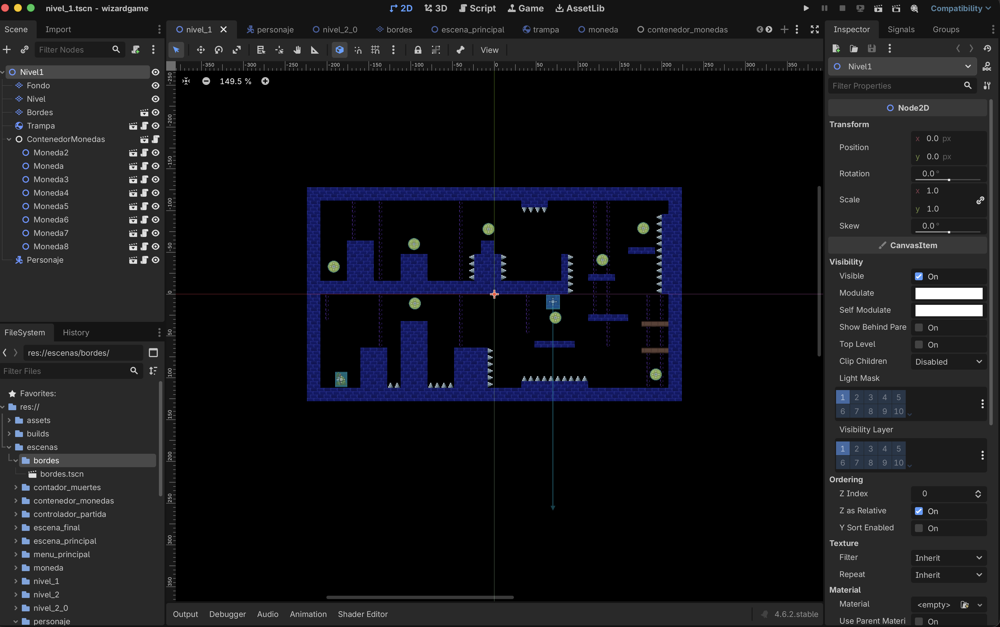
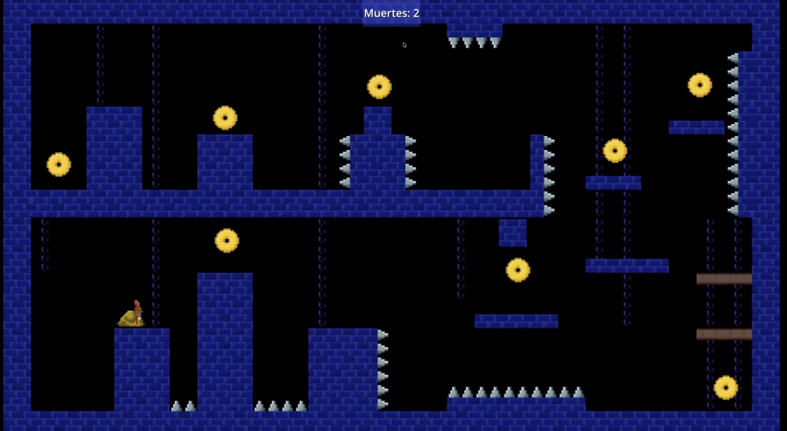
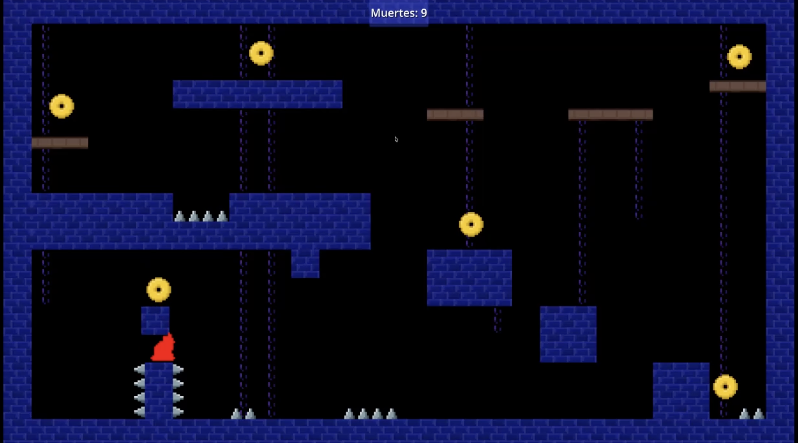

# Wizard Game — 2D Platformer

Videojuego de plataformas en 2D desarrollado con **Godot Engine**, utilizando una estética pixel art y diferentes niveles diseñados para desafiar las habilidades del jugador.

El juego consiste en controlar a un personaje a través de escenarios con plataformas, obstáculos y trampas, mientras se recolectan monedas y se intenta completar cada nivel. Incorpora mecánicas de movimiento, saltos, detección de colisiones y un contador de muertes para registrar los intentos del jugador.

## Tecnologías Utilizadas

- **Motor de Desarrollo:** Godot Engine 4
- **Lenguaje de Programación:** GDScript
- **Diseño de Niveles:** Escenas 2D y sistema de nodos de Godot
- **Gráficos:** Sprites y recursos visuales Pixel Art

## Capturas del Juego

### Diseño de Niveles

Escenarios 2D con plataformas, monedas coleccionables y obstáculos distribuidos para crear distintos desafíos durante el recorrido.

<p align="center">
  
</p>

### Gameplay

El jugador debe desplazarse por los niveles, superar obstáculos y evitar las trampas mientras recolecta monedas. El juego registra las muertes durante los intentos de completar cada escenario.

<p align="center">
  
  
</p>

## Cómo Ejecutar el Juego

1. Descargar e instalar [Godot Engine](https://godotengine.org/download/).
2. Clonar el repositorio:

   ```bash
   git clone https://github.com/Fabian-Montero/wizardgame-repo.git
   ```

3. Abrir Godot Engine y seleccionar **Importar**.
4. Buscar el archivo `project.godot` dentro de la carpeta del proyecto.
5. Importar el proyecto y abrirlo en el editor.
6. Presionar **F6** para ejecutar la escena actual o **F5** para ejecutar el proyecto completo, siempre que tenga configurada su escena principal.